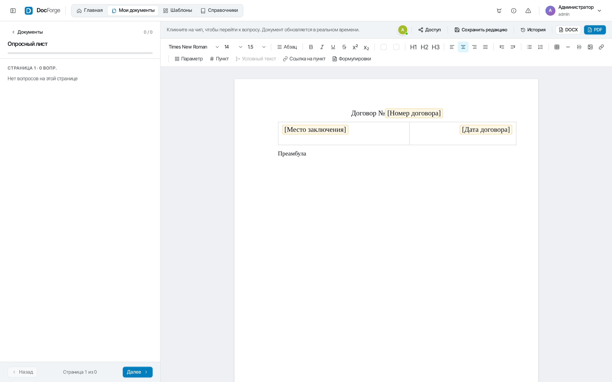
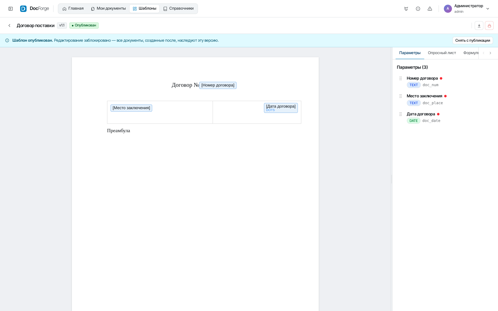
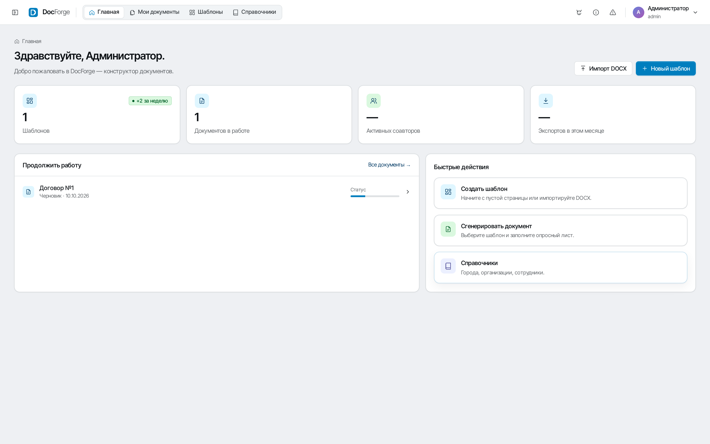
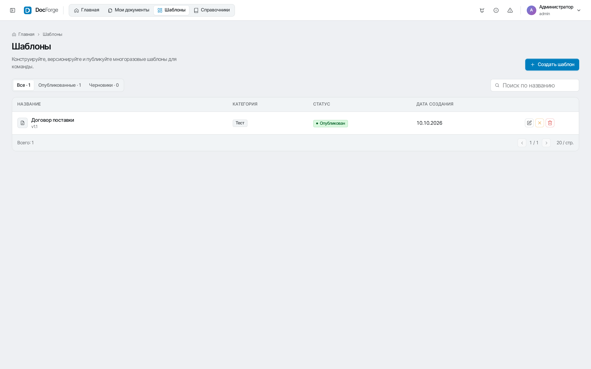
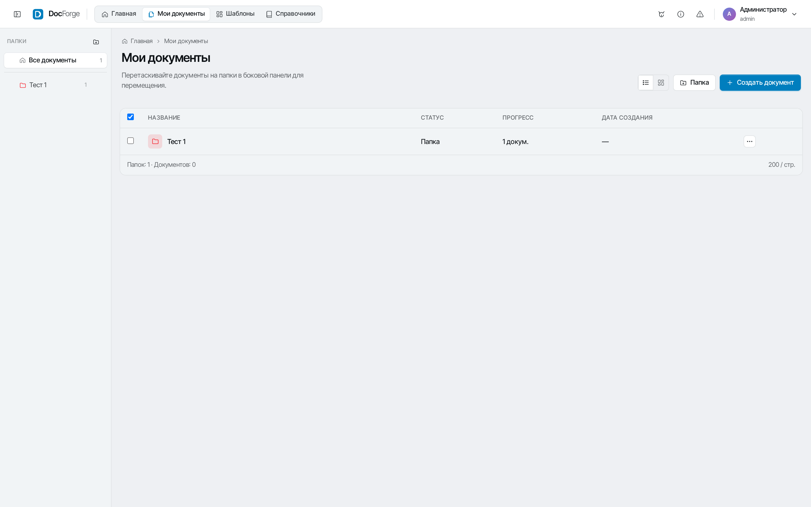
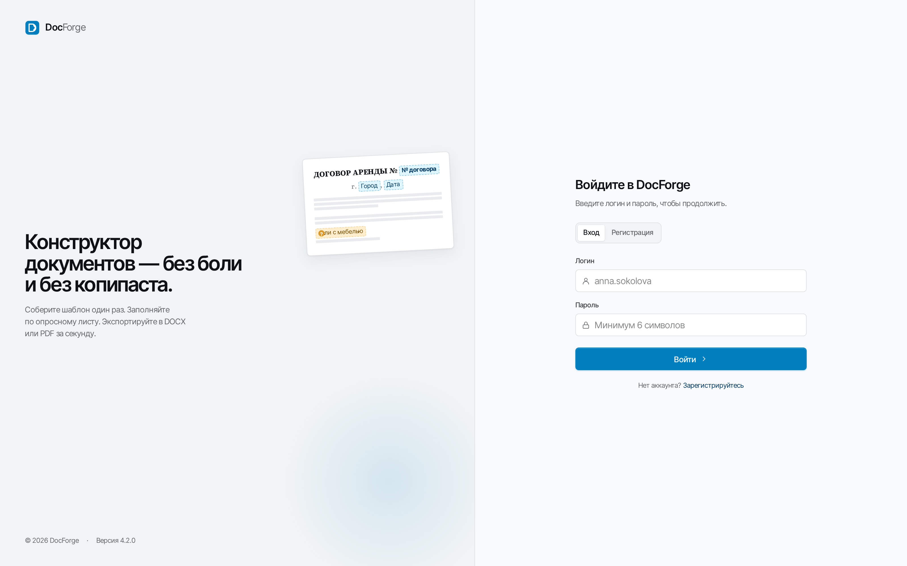

<div align="center">

# DocForge

**Конструктор юридических и деловых документов** — собирайте параметризованные шаблоны, заполняйте их через опросный лист, редактируйте совместно в реальном времени и экспортируйте в DOCX или PDF.

</div>

<p align="center">
  
  
  
  
  
  
  
  
  
  
  
</p>

---

## Демонстрация

<p align="center">
  
  <br/>
  <em>Заполнение документа: опросный лист слева, живой WYSIWYG-редактор справа</em>
</p>

<p align="center">
  
  <br/>
  <em>No-code конструктор шаблонов: параметрические поля, условные блоки, панель параметров</em>
</p>

<p align="center">
  
  
  <br/>
  <em>Рабочий стол · Каталог шаблонов</em>
</p>

<p align="center">
  
  
  <br/>
  <em>Список документов · Экран входа</em>
</p>

## Возможности

- **No-code конструктор шаблонов** — WYSIWYG-редактор на TipTap 3: параметрические поля, условные блоки и inline-условия, нумерованные пункты с автонумерацией, таблицы, slash-команды.
- **Параметры 7 типов** — текст, число, дата, ФИО, boolean, выбор из списка, справочники. Форматирование: склонение ФИО, даты, пробелы в числах.
- **Опросный лист** — вопросы привязаны к параметрам, разделены по страницам, видимость управляется условиями. Заполнение с мгновенным обновлением документа.
- **Вариативность** — простые условия (`==`, `>`, `in`, AND/OR) или **Python-скрипты в sandbox** (GraalPython: без FS, сети и Java-классов, таймаут 2 с).
- **Совместное редактирование** — Yjs + WebSocket: курсоры, выделения, awareness участников, документ сохраняется в MongoDB.
- **История редакций** — автоматические ревизии при сохранении, откат к любой версии.
- **Экспорт** — DOCX (Apache POI) и PDF (TipTap JSON → HTML → openhtmltopdf).
- **Справочники** — пользовательские реестры с настраиваемой схемой полей (PostgreSQL + MongoDB).
- **Аудит-лог** — кто и что делал с шаблонами и документами.
- **Контейнеризация** — один `docker-compose up` поднимает PostgreSQL, MongoDB, Redis.

## Стек технологий

| Слой | Технологии |
|---|---|
| Backend | Java 21 · Spring Boot 3.3 · Virtual Threads · Spring WebSocket |
| Frontend | React 18 · TypeScript · shadcn/ui + Tailwind · TipTap 3 (ProseMirror) |
| Коллаборация | Yjs (CRDT) · y-websocket |
| Хранилища | PostgreSQL 16 (JPA · Flyway) · MongoDB 7 · Redis 7 |
| Скрипты | GraalPython (sandbox, таймаут) |
| Экспорт | Apache POI 5 (DOCX) · openhtmltopdf (PDF) |
| Инфраструктура | Docker · Docker Compose · Vite · Gradle (Kotlin DSL) |

## Архитектура

Модульный монолит: `user`, `template`, `document`, `collaboration`, `directory`, `export`, `audit`, `upload`, `feedback`, `security`, `common`.
Модули общаются **только через интерфейсы `*Service`** — репозитории никогда не импортируются между модулями, что сохраняет возможность разрезки на сервисы.

Генерация документа — конвейер: `валидация ответов → вычисление условий → фильтрация условных блоков → подстановка параметров с форматированием → сохранение`.

```
Браузер (React + TipTap + Yjs)
        │  REST / WebSocket
        ▼
Spring Boot 3.3 ───► Template · Document · Collaboration · Directory · Export
        │  │  │
        ▼  ▼  ▼
  PostgreSQL   MongoDB   Redis      GraalPython sandbox
  (users,      (templates,           (условия + скрипты,
   registry,    body, documents,      вариативность)
   audit)       directories)
```

Документация:

- [`docs/architecture.md`](docs/architecture.md) — ТЗ, модель данных, API-контракты
- [`docs/specs/layers.md`](docs/specs/layers.md) — правила слоёв и межмодульного взаимодействия
- [`docs/specs/workflows.md`](docs/specs/workflows.md) — процесс разработки и quality gates

## Быстрый старт

### Требования

- Java 21+
- Node.js 18+
- Docker & Docker Compose

### Запуск

```bash
# 1. Инфраструктура (PostgreSQL, MongoDB, Redis)
docker-compose up -d

# 2. Backend (Spring Boot)
cd backend && ./gradlew bootRun   # http://localhost:8080

# 3. Frontend (Vite)
cd frontend && npm install && npm run dev   # http://localhost:5173
```

Демо-доступ: `admin` / `admin123`.

### Тесты

```bash
# Backend: unit (JUnit 5 + Mockito) и интеграционные (*IT, Testcontainers)
cd backend && ./gradlew test

# Frontend: Vitest + React Testing Library
cd frontend && npm run test

# E2E: Playwright
npx playwright test
```

## Структура проекта

```
DocForge/
├── backend/                    # Spring Boot 3.3
│   └── src/main/java/com/docforge/
│       ├── user/ template/ document/ collaboration/
│       ├── directory/ export/ audit/ upload/ feedback/
│       └── security/ common/
├── frontend/                   # React 18 + TypeScript
│   └── src/
│       ├── api/ components/ pages/
│       ├── store/ types/ utils/
├── docs/                       # Архитектура, спецификации, дизайн
│   └── screenshots/            # Скриншоты приложения
├── docker-compose.yml          # PostgreSQL + MongoDB + Redis
└── Dockerfile
```

## Лицензия

[MIT](LICENSE)